<div align="center">
<picture>
  <source media="(prefers-color-scheme: dark)" srcset=".github/brand/banner-night.svg">
  
</picture>
<br><br>
<a href="#prerequisites"><picture><source media="(prefers-color-scheme: dark)" srcset=".github/brand/tab-prerequisites-night.svg"></picture></a>
<a href="#installation"><picture><source media="(prefers-color-scheme: dark)" srcset=".github/brand/tab-installation-night.svg"></picture></a>
<a href="#controls"><picture><source media="(prefers-color-scheme: dark)" srcset=".github/brand/tab-controls-night.svg"></picture></a>
<a href="#game-modes"><picture><source media="(prefers-color-scheme: dark)" srcset=".github/brand/tab-game-modes-night.svg"></picture></a>
<a href="#customization"><picture><source media="(prefers-color-scheme: dark)" srcset=".github/brand/tab-customization-night.svg"></picture></a>
<a href="#credits"><picture><source media="(prefers-color-scheme: dark)" srcset=".github/brand/tab-credits-night.svg"></picture></a>
<a href="#authors"><picture><source media="(prefers-color-scheme: dark)" srcset=".github/brand/tab-authors-night.svg"></picture></a>
<a href="#license"><picture><source media="(prefers-color-scheme: dark)" srcset=".github/brand/tab-license-night.svg"></picture></a>
</div>

<br>

Pot Pot Golf is a 3D physics-driven golf simulation built with LWJGL. Navigate procedurally generated terrain with realistic ball dynamics, sand traps, water hazards, and intelligent AI bots.

<p>
<a name="prerequisites"></a>
<picture><source media="(prefers-color-scheme: dark)" srcset=".github/brand/section-prerequisites-night.svg"></picture>
</p>

- Java 22+
- Maven

<p>
<a name="installation"></a>
<picture><source media="(prefers-color-scheme: dark)" srcset=".github/brand/section-installation-night.svg"></picture>
</p>

```bash
git clone https://github.com/NoamFav/Pot_Pot_Golf.git
cd Pot_Pot_Golf
mvn clean package
mvn exec:exec
```

> **Mac users:** Add `-XstartOnFirstThread` as a JVM argument when running from an IDE.

<p>
<a name="controls"></a>
<picture><source media="(prefers-color-scheme: dark)" srcset=".github/brand/section-controls-night.svg"></picture>
</p>

### Camera
| Key | Action |
|-----|--------|
| WASD | Move horizontally |
| Space / Shift | Move up / down |
| Right Mouse + Drag | Rotate |

### Game
| Key | Action |
|-----|--------|
| Q | Teleport to ball |
| ↓ | Teleport to hole |
| ↑ | Teleport to start |
| R | Reset all balls |
| Esc | Open menu |
| 1 | AI bot takes a shot |
| 2 | Rule-based bot takes a shot |

<p>
<a name="game-modes"></a>
<picture><source media="(prefers-color-scheme: dark)" srcset=".github/brand/section-game-modes-night.svg"></picture>
</p>

- **Single Player** — navigate the course and beat your personal best
- **Multiplayer** — two players take turns on the same course
- **Bot Mode** — watch the AI (Minimax) or rule-based bot play
- **Debug Mode** — customize start/hole positions, terrain, and physics

<p>
<a name="customization"></a>
<picture><source media="(prefers-color-scheme: dark)" srcset=".github/brand/section-customization-night.svg"></picture>
</p>

All physics, terrain, and visual settings are configurable via the `Consts` class — gravity, friction coefficients, simplex noise parameters, FOV, and more.

<p>
<a name="credits"></a>
<picture><source media="(prefers-color-scheme: dark)" srcset=".github/brand/section-credits-night.svg"></picture>
</p>

- Terrain textures — upklyak (Freepik)
- Tree models — printable_models (Free3D)
- Skybox — KIIRA (OpenGameArt)
- Font — Mighty Souly by graphicsauceco
- Background music — Fernweh Goldfish (UppBeat)

<p>
<a name="authors"></a>
<picture><source media="(prefers-color-scheme: dark)" srcset=".github/brand/section-authors-night.svg"></picture>
</p>

Noam Favier, Ole Rotteveel, Beatrice Boccolari, Bruna Calvancati Lauro, Evi Levels, Ahmet Akman, Nehir Sarihan

<p>
<a name="license"></a>
<picture><source media="(prefers-color-scheme: dark)" srcset=".github/brand/section-license-night.svg"></picture>
</p>

MIT — see [LICENSE](LICENSE).

<div align="center">
Made with ❤️ by <a href="https://github.com/NoamFav">NoamFav</a>
</div>

<br>

<a href="https://nf-software.com">
<picture>
  <source media="(prefers-color-scheme: dark)" srcset=".github/brand/footer-night.svg">
  
</picture>
</a>
